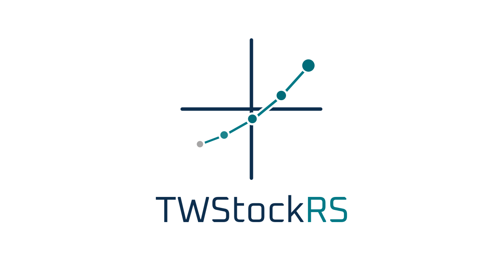
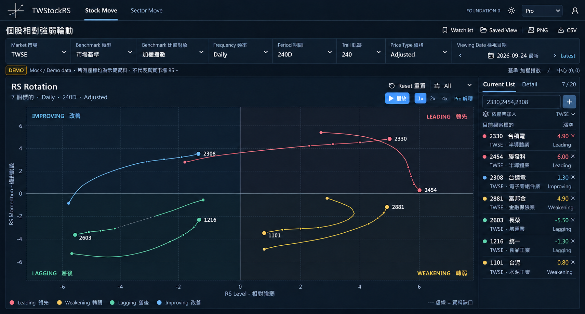
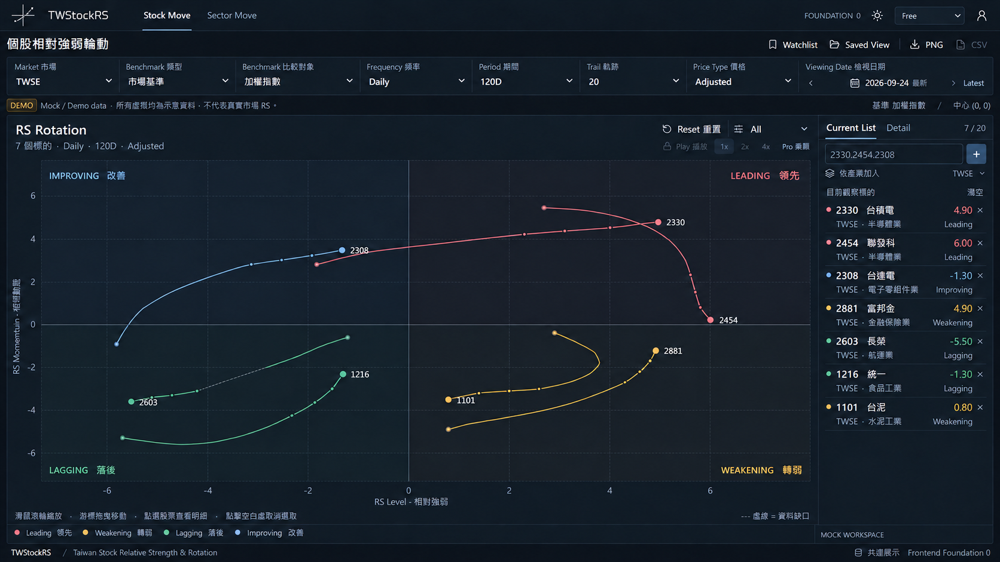
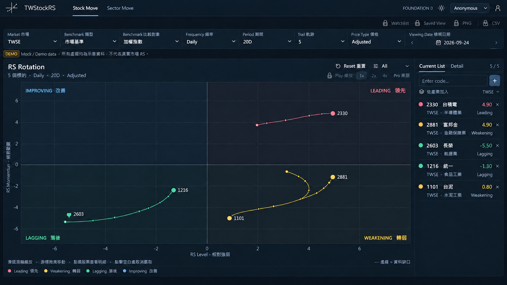
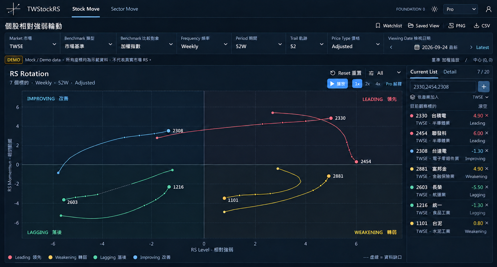

# TWStockRS｜台股相對強弱輪動分析

TWStockRS 是用來觀察台股個股與產業相對強弱變化的本機網站原型。圖表將標的放在「領先、轉弱、落後、改善」四個象限，並以路徑呈現不同日期的位置變化。

> **目前狀態：**這是本機原型，尚未開放公開網站。下方是依原型整理的**介面示意圖**，使用 DEMO 模擬資料；圖上的數值與軌跡不代表真實行情，也不構成投資建議。介面細節以實際程式為準。

## 介面展示

### Pro：日頻最大設定

Period（觀察期間）**240D**、Trail（最多顯示的軌跡點數）**240**。Pro 版提供週頻、播放及進階比較設定。

### Free：日頻最大設定

Period **120D**、Trail **20**。可操作圖表、管理觀察清單與儲存檢視；Pro 功能會顯示鎖定狀態。

### Anonymous（匿名）：日頻固定設定

Period 固定 **20D**、Trail 固定 **5**，清單最多 **5 個標的**。觀察清單、儲存檢視、匯出與播放會顯示鎖定狀態。

### Pro：週頻最大設定

Weekly（週頻）的 Period 上限為 **52W**，Trail 上限為 **52**。Free 目前只提供 Daily（日頻）。

## 主要功能

- 輪動圖表：查看個股或產業的相對強弱位置、移動路徑及選取標的明細；可縮放、平移與重置視野。
- 比較條件：切換上市／上櫃市場、比較基準、日／週頻、期間、軌跡與檢視日期。週頻與部分比較對象屬 Pro 功能。
- 工作區：管理 Watchlist（觀察清單）與 Saved View（已儲存的檢視設定），並依方案匯出 PNG 圖片或 CSV 表格。
- 本機資料架構：後端具備帳號權限、行情版本、相對強弱運算、備份還原與背景工作功能；正式行情來源及公開部署仍在準備。

資料說明：DEMO 指內建示範資料；D 表示交易日觀察期間，W 表示週觀察期間。畫面中的最大設定是方案允許的上限，實際可顯示的軌跡點數仍取決於已啟用資料版本及有效歷史。
